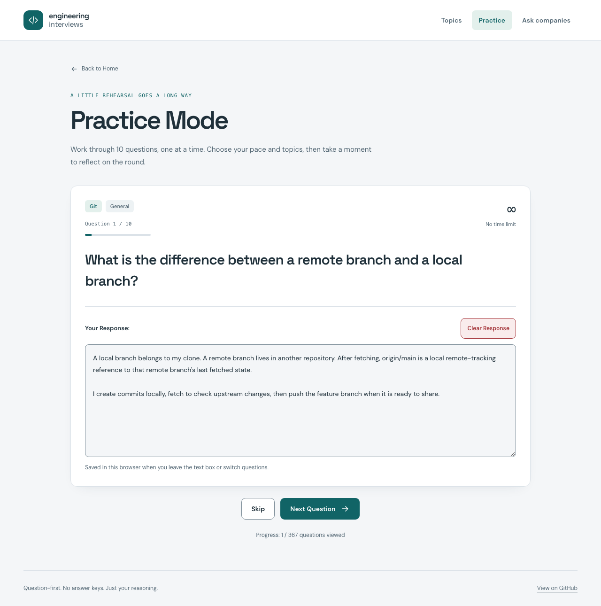

# Engineering interviews

[](https://github.com/mbianchidev/engineering-interviews/actions/workflows/ci.yml)
[Website](https://mbianchidev.github.io/engineering-interviews/) | [Documentation](docs/README.md) | [Issues](https://github.com/mbianchidev/engineering-interviews/issues)

[](https://mbianchidev.github.io/engineering-interviews/practice)

*The current practice website, shown with a synthetic example response.*

Practice explaining engineering decisions, not memorizing answer keys. Engineering interviews is a static website for candidates rehearsing their reasoning and interviewers preparing a question set, covering fundamentals, software engineering, system design, coding, observability, SRE, and platform engineering.

**[Open the practice website](https://mbianchidev.github.io/engineering-interviews/)** to browse and practice the questions. No installation or account is required. The bank mixes hiring-manager and candidate experience; coding prompts are open-ended scenarios rather than company-specific take-home assignments.

## Contents

[Quickstart](#quickstart) | [Why Engineering interviews](#why-engineering-interviews) | [How it works](#how-it-works) | [Configuration](#get-started-and-configuration) | [Features](#features) | [Documentation](#documentation) | [AI policy](#ai-policy) | [Contributing](#contributing) | [Security](#security) | [License](#license)

## Quickstart

Open the [website](https://mbianchidev.github.io/engineering-interviews/), select **Start Practicing**, choose **Easy**, and leave the topic filter empty. Start the round to see the first of ten questions and write a response.

For local development, use **Node.js 26.12.1 (current stable), npm, and Git**, matching CI:

```bash
git clone https://github.com/mbianchidev/engineering-interviews.git
cd engineering-interviews
npm ci
npm run dev
```

Open [http://localhost:3000](http://localhost:3000). The home page provides Start Practicing, Browse Topics, and Questions to Ask Companies. No database, Docker setup, API keys, or environment file is required. CI uses `ubuntu-latest` GitHub-hosted Linux runners; the website needs a browser with JavaScript enabled.

## Why Engineering interviews

Use topic browsing for focused study, random rounds to rehearse under time pressure, and company questions to make interviews a two-way conversation. Questions intentionally have no answer keys, automated grading, or code execution: explain your assumptions and trade-offs, then reflect on your own performance.

Answers and progress stay in your browser instead of an account or backend. That also means no cross-device sync or recovery after clearing browser storage.

## How it works

Choose topics, answer ten randomly selected questions, and rate your confidence, effectiveness, and knowledge after each round. Browse Topics lets you revisit saved answers; Questions to Ask Companies covers team culture, growth, and role expectations.

The site uses Next.js 16 App Router, React 19, TypeScript, and Tailwind CSS. Builds parse the archived Markdown question source, generate client data and topic pages, and export a static website. The README is a landing page, not the question source. See the [developer guide](SETUP.md#stack-and-structure) for the data flow and repository map.

## Get started and configuration

Leave all topics unselected to use the full bank. A topic filter must contain at least ten questions in total.

| Mode | Time per question | Unused time |
| --- | --- | --- |
| Easy | No time limit | Not applicable |
| Standard | Five minutes | Rolls into an extra-time pool for later questions in the round |
| Hard | Five minutes | Does not roll over |

Timed modes advance automatically when time runs out. Responses save when the text box loses focus or you move to the next question. Local storage must be available to retain responses, viewed-question IDs, and evaluations. Active rounds and timers do not survive a page reload, and the hosted and local sites do not share saved work.

For hosting, `npm run build` creates `out/`. `DEPLOY_ENV=github-pages npm run build` selects the `/engineering-interviews` prefix; GitHub Actions selects it automatically. `npm start` is not a preview server for this static export. See [setup and deployment](SETUP.md) for the full workflow and [saved-work guidance](docs/practice.md#saved-work-and-resetting) before clearing data.

## Features

- **Browse by topic:** Expand questions, write responses, and revisit or clear saved answers.
- **Practice rounds:** Ten questions per round with optional category and subtopic filters.
- **Choose your pace:** Untimed practice or five-minute questions, with optional time rollover.
- **Reflect on progress:** Track viewed questions and review browser-local self-evaluations.
- **Interview the company:** Explore questions about culture, growth, work-life balance, and role fit.

## Documentation

Start with the [documentation index](docs/README.md) for the [practice guide](docs/practice.md), [local setup and deployment](SETUP.md), and [question-authoring instructions](SETUP.md#editing-questions).

See [ACCESSIBILITY.md](ACCESSIBILITY.md) for contribution targets, verification practices, known limitations, and reporting accessibility barriers.

The practice guide also preserves the [STAR method](docs/practice.md#star-method) and [useful resources](docs/practice.md#useful-resources). Platform scenarios draw inspiration from the [Platform Engineering Roadmap](https://platform-engineering-roadmap.mbianchi.dev/).

## AI policy

You are responsible for everything you contribute, including AI-assisted code, documentation, and assets. Review and test your contribution. You must be able to explain what the code does and why it is needed.

## Contributing

Contributions are welcome; inclusion remains at the maintainer's discretion. Read [CONTRIBUTING.md](CONTRIBUTING.md) for setup, question-editing, and review guidance. Coding agents must also read [AGENTS.md](AGENTS.md), including the temporary dependency-backport TODO.

Participation follows the [Contributor Covenant Code of Conduct](CODE_OF_CONDUCT.md).

## Security

Report vulnerabilities through the repository's enabled [private reporting channel](https://github.com/mbianchidev/engineering-interviews/security/advisories/new), not public issues. [SECURITY.md](SECURITY.md) covers supported versions, best-effort responses, and coordinated disclosure.

## License

Licensed under the [GNU Affero General Public License v3.0](LICENSE).

The [Code of Conduct](CODE_OF_CONDUCT.md#attribution) retains Contributor Covenant's CC BY-SA 4.0 attribution and license.
