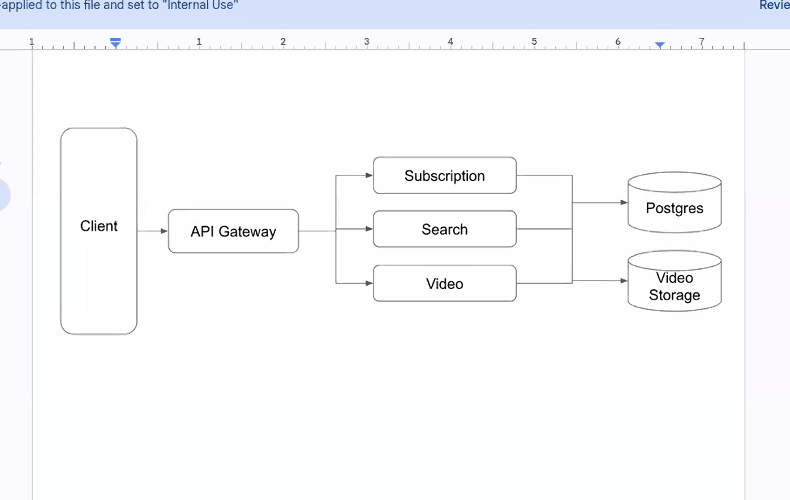

# Staff Field Engineer Interview Prep

These answer templates cover role and enablement topics, peer-level observability questions, and a critical-code-review scenario. Adapt them to your own experience rather than memorizing them verbatim; add concrete examples and outcomes where you can.

## Role, enablement, and Kubernetes

### 1. Tell me about yourself and why this role?

“I work at the intersection of technical depth and customer impact. I enjoy helping teams turn complex technology into something they can confidently explain and demonstrate. This role appeals to me because it combines enabling Solutions Engineers with keeping the Kubernetes infrastructure behind those experiences reliable.”

### 2. How would you help Solutions Engineers do their best work?

“I’d learn where they lose time—environment setup, demo failures, unclear guidance, or repeated customer questions—and remove those bottlenecks. I’d build reusable demo patterns, clear runbooks, and hands-on training, then check whether those changes actually make demos faster and more dependable.”

### 3. How would you design reliable observability demo environments on Kubernetes?

“I’d start with the demo journeys and their reliability needs, then make environments reproducible and isolated. I’d use declarative deployment, resource limits, health checks, and clear reset and cleanup processes. I’d monitor both the cluster and the demo experience, so we know whether a demo is ready—not just whether its pods are running.”

### 4. A demo environment breaks shortly before a customer meeting. What do you do?

“First, I’d establish impact and find the quickest safe path to a working demo—such as restoring a known-good environment or switching to a fallback. Then I’d communicate clearly with the Solutions Engineer, investigate using logs, metrics, and events, and follow up with a fix that prevents recurrence. I’d avoid risky changes just to hide the immediate symptom.”

### 5. How do you troubleshoot an issue spanning Kubernetes and the observability stack?

“I’d narrow the problem by layer: user impact, application behavior, service dependencies, and cluster health. I’d correlate metrics, logs, traces, and Kubernetes events around the same time window, test a specific hypothesis, and keep the Solutions Engineer or customer updated. I’d distinguish evidence from assumptions and document the resolution.”

### 6. How do you make observability useful rather than overwhelming?

“I start with the questions someone needs to answer: what’s broken, who is affected, and where should they look next? Then I choose signals and dashboards that support those decisions, with useful labels, sensible alerting, and links between metrics, logs, and traces. More telemetry isn’t automatically more insight.”

### 7. How would you help a Solutions Engineer translate a customer’s problem into an observability solution?

“I’d help clarify the customer’s goals, current data sources, constraints, and definition of success before discussing products. Then I’d map the use case to a practical architecture and demonstrate the important workflow end to end. I’d be clear about trade-offs and avoid promising capabilities the solution doesn’t provide.”

### 8. How do you balance standard demos with customer-specific needs?

“I’d keep a reliable, tested core demo and make customization deliberate. Common variations should become reusable options; one-off changes should be isolated so they don’t destabilize the baseline. That lets Solutions Engineers respond to customers without turning every demo environment into a unique snowflake.”

### 9. How do you influence teams when you don’t manage them?

“I build trust by understanding their priorities and making the next step easier. I bring concrete evidence—such as repeated setup failures or time lost before demos—then propose a small improvement, invite feedback, and show the result. I aim to create shared ownership rather than impose a process.”

### 10. How would you measure success in this role?

“I’d look at both technical reliability and Solutions Engineer effectiveness: demo readiness and failure rates, recovery time, time to provision or reset environments, and whether people can run and adapt demos independently. I’d pair those measures with regular feedback, because a dashboard can show uptime without showing whether the demo is actually helping the conversation.”

## Peer technical: logs, metrics, traces, and Kubernetes

### 1. How would you instrument a service with OpenTelemetry and get its telemetry into an observability platform?

“I’d instrument the service with the OpenTelemetry SDK and export OTLP. In Kubernetes, I’d use a collector such as Alloy or the upstream OpenTelemetry Collector to receive, process, and route telemetry to the right backends. I’d confirm resource attributes and service identity are consistent so the data is usable across signals.”

### 2. What’s the difference between OpenTelemetry and Alloy?

“OpenTelemetry is a set of vendor-neutral APIs, SDKs, data conventions, and protocols for generating and moving telemetry. Alloy is a collector distribution: it can receive, process, and export telemetry, including OpenTelemetry data. I’d choose the collector based on requirements such as integrations, deployment model, configuration, and operational support.”

### 3. A service’s metrics are visible, but its traces aren’t. How would you investigate?

“I’d check the trace path end to end: SDK configuration, OTLP endpoint and protocol, collector receiver and exporter health, network access, and backend ingestion. Then I’d inspect sampling and context propagation—especially across service boundaries. Metrics arriving only proves part of the pipeline works; it doesn’t prove traces are being created, sampled, or exported.”

### 4. How do logs, metrics, and traces complement each other?

“Metrics show that something is wrong and help identify the scope; traces show where time or errors occur across a request; logs provide detailed event context. I’d connect them with consistent service and environment attributes, trace and span IDs where appropriate, and the dashboard/UI’s correlation features. The goal is to move from an alert to the relevant request and its supporting evidence quickly.”

### 5. What causes high-cardinality metrics, and how do you control it?

“A label with many distinct values—like user IDs, request IDs, or raw URLs—can create a huge number of time series. I’d keep metric labels bounded, move high-detail investigation to logs or traces, and review cardinality before adding dimensions. For a Prometheus-compatible backend such as Mimir, that helps control resource use and query performance.”

### 6. How would you troubleshoot logs that are missing or slow to query in Loki?

“I’d check collection first: are the pods producing logs, and is the collector discovering and tailing the right files or streams? Then I’d inspect collector errors, labels, tenant or endpoint configuration, and Loki ingestion health. For query performance, I’d look at the time range and label selectors, and avoid using high-cardinality labels as the main way to find logs.”

### 7. When would you use head sampling versus tail sampling for traces?

“Head sampling makes the decision early, so it’s simpler and reduces work throughout the pipeline, but it may drop rare errors or slow traces. Tail sampling can make decisions after seeing more of a trace, which helps retain interesting traces, but needs more buffering and coordination. I’d choose based on the retention goals, traffic, cost, and collector architecture—and check that the policy doesn’t break trace completeness.”

### 8. Which products or components would you use for a full observability workflow?

“The dashboard/UI is where teams explore, visualize, and alert on telemetry. Loki is for logs, Mimir for scalable Prometheus-compatible metrics, Tempo for distributed traces, and Pyroscope for profiles; Alloy can collect and route telemetry. I’d choose a managed or self-managed approach based on operational ownership, scale, required capabilities, support, and cost.”

### 9. A dashboard says the service is healthy, but customers report slow requests. What do you check?

“First I’d verify that the dashboard reflects the affected service, route, and time window. Then I’d compare latency percentiles and error rates, inspect representative traces for slow spans or dependency delays, and use related logs to investigate specific failures. I’d also check whether the metrics hide a problem—for example, averages masking tail latency or missing instrumentation for a dependency.”

### 10. How would you make observability reliable in Kubernetes demo environments?

“I’d make the environment reproducible, use a collector configuration checked into source control, and validate the whole path with a known workload that emits telemetry. I’d monitor collector health and resource limits, and verify that dashboards, queries, and alerts work—not just that pods are ready. I’d also provide a reset or fallback path so a demo remains usable if an environment gets into a bad state.”

## System-design diagram

*The supplied diagram is preserved as provided. It shows a client, an API gateway, three services, Postgres, and video storage.*

One reasonable reading is that a client calls an API gateway, which routes to Subscription, Search, and Video services, with Postgres and video storage behind them. The storage connections are ambiguous, so clarify whether every service accesses both stores and which calls are synchronous.

If asked how to instrument this design:

“I’d propagate OpenTelemetry trace context from the gateway through each service and into database or storage calls, so we can follow a request end to end. I’d collect request rate, errors, and latency for each service, with structured logs correlated by trace ID. I’d keep metric labels bounded and avoid putting user or video IDs in them. Alloy or an OpenTelemetry Collector can process and route the data; the dashboard/UI can correlate Prometheus/Mimir metrics, Loki logs, and Tempo traces. Then I’d build views around user-facing latency and failures, not just pod health.”

## Reviewing a very large AI-generated pull request for a critical internal tool

### What goes through your mind when you start the review? What yellow flags do you look for, and what conversation would help you feel confident about merging?

> “I wouldn’t start by trying to decide whether AI wrote it. I’d treat the size and risk of the change as the issue: this is a critical internal tool, so I need to understand what’s changing, why, and how we’ll know it’s safe.
>
> My yellow flags would be a diff that mixes unrelated work, broad rewrites without a clear reason, new dependencies or abstractions that seem disproportionate, and tests that mostly mirror the implementation rather than verify important behavior. I’d pay particular attention to error handling, permissions, data migrations, concurrency, and failure recovery. Another flag is when the pull request description doesn’t explain trade-offs or how to roll back.
>
> I’d talk with the engineer collaboratively: ‘Can you walk me through the design and the riskiest parts? What alternatives did you consider? What should happen when this dependency fails? Which tests cover that case, and how would we roll back?’ I’d also ask them to trace one important behavior from entry point through to its effects. I’m not looking for them to recite every line; I want to see that they understand the behavior and can make informed changes if something goes wrong.
>
> If the change is too large to review confidently, I’d ask to split it into smaller, reviewable pull requests or add focused tests and documentation before merging. AI assistance isn’t a reason to reject code—but for critical systems, the author still needs to own it, explain it, and provide evidence that it’s safe. A green CI run alone wouldn’t give me enough confidence.”
